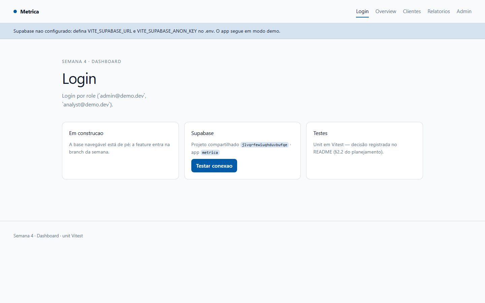
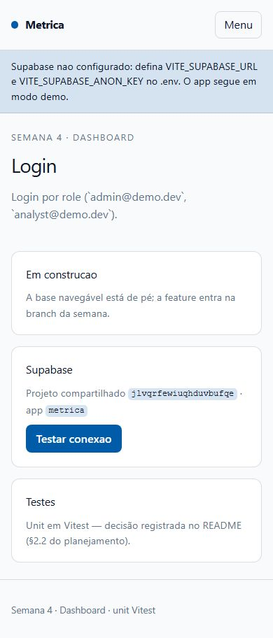
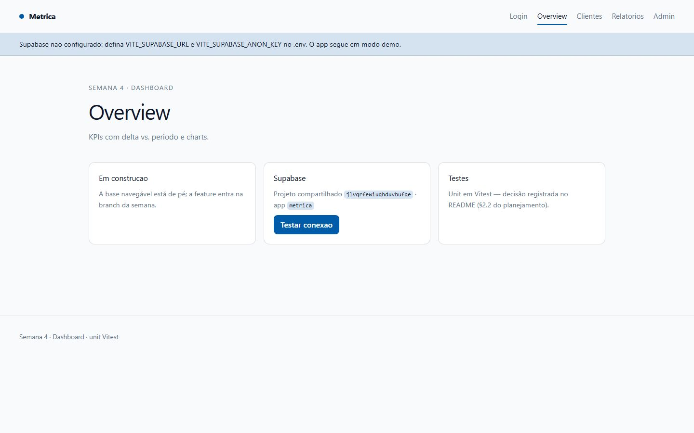
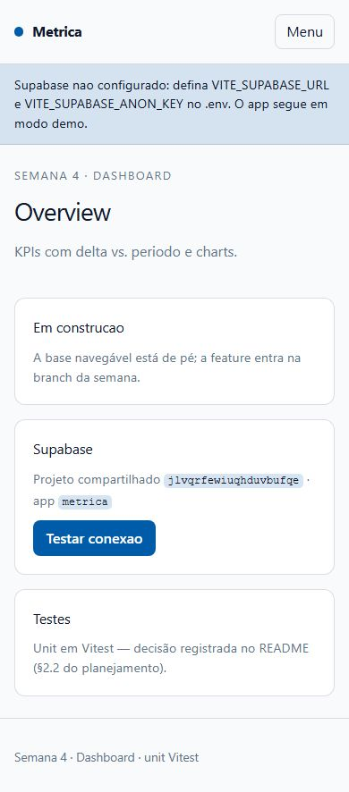
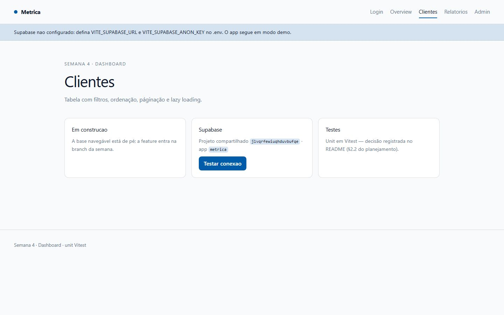
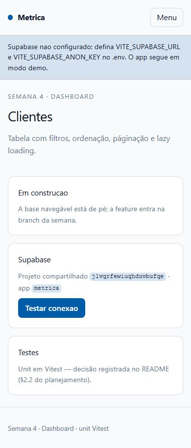
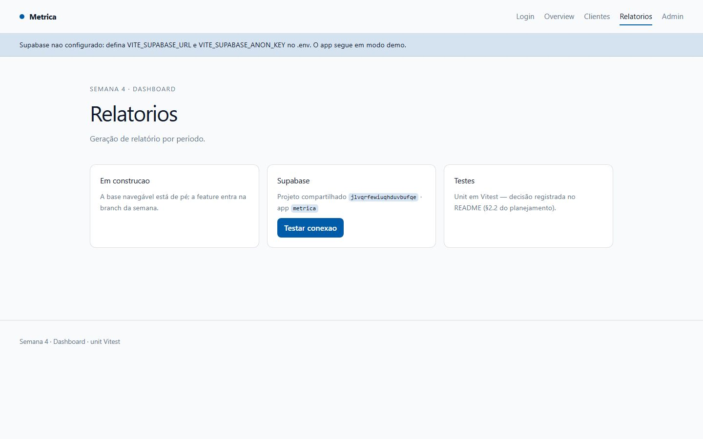
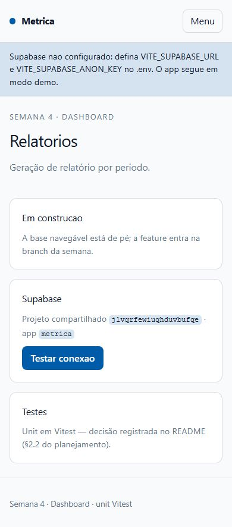
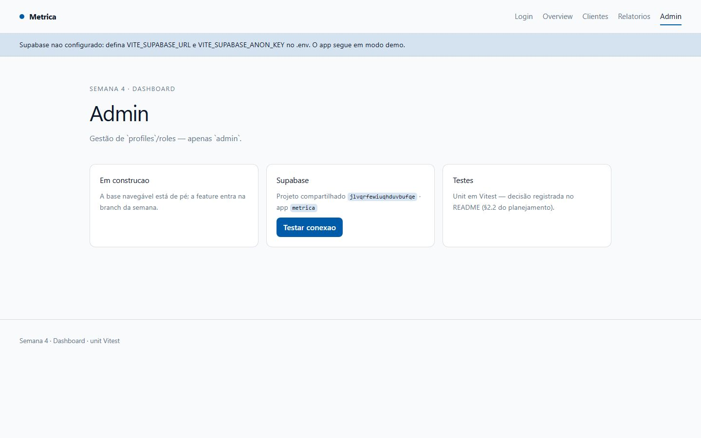
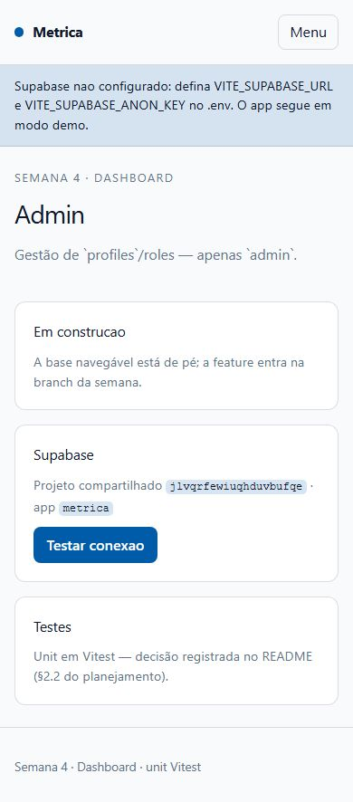

# Metrica — Painel Administrativo de BI


> Painel administrativo corporativo — KPIs, roles/permissões, tabelas complexas e lazy loading.
> Pilar **Dashboard** · Semana 4 do roadmap Angular + Supabase · Milestone `m1-metrica` · Demo pública no GitHub Pages.

---

## Screenshots do Produto

### Login
| Desktop | Mobile |
|---------|--------|
|  |  |

### Overview
| Desktop | Mobile |
|---------|--------|
|  |  |

### Clientes
| Desktop | Mobile |
|---------|--------|
|  |  |

### Relatórios
| Desktop | Mobile |
|---------|--------|
|  |  |

### Admin
| Desktop | Mobile |
|---------|--------|
|  |  |

> **Baselines:** 10 screenshots (5 rotas × desktop/mobile) versionadas em `docs/screenshots/`, geradas por `e2e/screenshots.spec.ts` (Playwright). Regerar com `npm run e2e:screenshots`.

---

## Documentação

| Arquivo | Descrição |
|---------|-----------|
| [`docs/metrica-bi-case.md`](./docs/metrica-bi-case.md) | Case study: contexto, desafio, solução, métricas e "o que aprendi" |
| [`docs/a11y/relatorio-axe.json`](./docs/a11y/relatorio-axe.json) | Relatório de acessibilidade (axe) das 5 rotas |
| [`docs/clarity-integracao.md`](./docs/clarity-integracao.md) | Integração do Microsoft Clarity (mapa de calor) |
| [`docs/manter-online.md`](./docs/manter-online.md) | Estratégia zero-standby (custo zero) |

---

## Setup Rápido

```bash
npm install          # instala dependências (o postinstall gera o ambiente)
npm start            # ng serve → http://localhost:4200
```

O app funciona **sem backend**: sem `VITE_SUPABASE_URL`/`VITE_SUPABASE_ANON_KEY` ele entra em
**modo demo** e exibe um aviso no topo, permitindo navegar por todas as rotas.

Para configurar o Supabase:

```bash
cp .env.example .env   # preencha as variáveis
npm start
```

---

## Comandos Principais

| Comando | Descrição |
|---------|-----------|
| `npm start` | Servidor de desenvolvimento (`ng serve`) |
| `npm run build` | Build de produção (`ng build`) |
| `npm run lint` | ESLint + angular-eslint |
| `npm test` | Testes unitários (Vitest, watch) |
| `npm run test:ci` | Testes unitários + cobertura (CI) |
| `npm run e2e` | Playwright (acessibilidade + screenshots) |
| `npm run e2e:a11y` | Varredura de acessibilidade (gera relatório axe) |
| `npm run e2e:screenshots` | Regenera os prints do README |
| `npm run env` | Gera `src/environments/ambiente.local.ts` a partir do `.env` |

> **Porta ocupada?** O Playwright aceita `E2E_BASE_URL` para apontar a um servidor já rodando:
> `npx ng serve --port 4320 &` + `E2E_BASE_URL=http://localhost:4320 npm run e2e`.

---

## Telas Implementadas

> A base navegável está de pé e completa (shell roteado + shell de health-check do Supabase).
> As features de cada tela entram nas branches das próximas semanas do roadmap.

| Tela | Rota | Conteúdo atual |
|------|------|----------------|
| Login | `/login` | Health-check do projeto Supabase compartilhado; app em modo demo sem credenciais |
| Overview | `/overview` | Base da tela de KPIs (delta vs. período e charts, feature da semana) |
| Clientes | `/clientes` | Base da tabela com filtros, ordenação, paginação e lazy loading |
| Relatórios | `/relatorios` | Base da geração de relatório por período |
| Admin | `/admin` | Base da gestão de `profiles`/roles (restrita a `admin`) |

`/` redireciona para `/login` (e `**` cai no mesmo redirect). O "login" atual é um **health-check**
do Supabase (botão *Testar conexão*), **sem formulário nem guard** — por isso todas as rotas são públicas
e podem ser varridas pelo axe e capturadas nos screenshots sem autenticação.

---

## Qualidade & Performance

| Métrica | Resultado |
|---------|-----------|
| **Unit tests (Vitest)** | 7/7 passando (6 arquivos) |
| **Cobertura** | 77,1% statements · 68,3% branches · 33,3% funcs · 79,2% lines |
| **E2E (Playwright)** | 11/11 passando (axe + 10 screenshots) |
| **Acessibilidade (axe)** | 0 violações graves/críticas nas 5 rotas |
| **Lighthouse** | Performance **100** · A11y **100** · Best Practices **100** · SEO **100** |
| **ESLint** | 0 erros · 0 warnings |
| **Bundle inicial** | 476,3 kB (≈115,1 kB transfer) |
| **Responsivo** | mobile (390) / desktop (1440) |

> FCP 1,4 s · LCP 1,5 s · TBT 80 ms · CLS 0 (Lighthouse, servidor estático local).
> **Aviso pré-existente:** o bundle inicial estoura o budget `maximumWarning` (350 kB) em ~126 kB —
> o grosso é o `@supabase/supabase-js`. Fica abaixo do `maximumError` (500 kB), então o build de
> produção passa; a meta de redução (lazy do client Supabase) está no roadmap de performance.

---

## Acessibilidade

Varredura automatizada com `@axe-core/playwright` (tags WCAG 2.0/2.1 A+AA) nas cinco rotas —
**zero violações** graves ou críticas (15 passes por rota).

- Link "Pular para o conteúdo" no topo do shell; foco visível global (`:focus-visible`).
- `prefers-reduced-motion` zera animações/transições.
- Contraste corrigido: o elemento `<code>` dos cartões usava `--tenue` sobre fundo azulado (3,7:1);
  agora usa `--texto` (≥ 13:1).
- Relatório versionado em [`docs/a11y/relatorio-axe.json`](./docs/a11y/relatorio-axe.json). Reproduzir: `npm run e2e:a11y`.

---

## Design — decisão e intenção

### Conceito

**Metrica** é um painel corporativo: claro, denso em informação e legível. A escolha é a de um
**produto de dados** (não de marketing) — por isso nada de animação decorativa: o que importa é a
hierarquia de títulos, o estado da conexão e a leitura rápida de números.

### Identidade visual

| Token | Valor | Para quê |
|-------|-------|----------|
| `--fundo` | `#f8fafc` (slate-50) | Fundo neutro, de baixo cansaço para sessões longas |
| `--superficie` | `#ffffff` | Cartões — separação clara das informações |
| `--texto` | `#0f172a` (slate-900) | Texto principal, contraste alto |
| `--tenue` | `#64748b` (slate-500) | Metadados/descrições — hierarquia sem gritar |
| `--acento` | `#005CA9` | Marca/ação: links ativos, botões, código, foco |
| `--borda` | `color-mix(#0f172a 14%)` | Divisórias suaves, sem ruído |

- **Tipografia:** `Inter` com `font-variant-numeric: tabular-nums` — números de colunas alinham na
  vertical, essencial em dashboard.
- **Formas:** cartões `rounded-0.75rem` com borda de 1 px; grade `auto-fit minmax(16rem, 1fr)` que
  reorganiza de 3 → 2 → 1 coluna sozinha.
- **Navegação:** link ativo marcado por borda inferior no acento; no mobile vira botão "Menu"
  (`aria-expanded` + `aria-controls`).

### Acessibilidade como decisão de design

O app nasce com `:focus-visible` visível, `lang="pt-BR"`, um único `<h1>` por tela e skip-link —
requisitos que o axe verifica a cada `npm run e2e:a11y`.

---

## Decisão de teste: Vitest

> Cada repo do roadmap alterna Karma/Vitest de propósito: agnóstico de ferramenta, escolha por contexto.

Neste repo o contexto é um **dashboard com lógica de estado** (signals, health-check, roles):

- **Nativo ESM + TypeScript:** o Vitest transforma os specs no mesmo pipeline do `ng build`.
- **CI sem browser:** roda em Node puro, mais rápido e estável que o Karma.
- **Karma em fim de vida:** o Angular já o marca como deprecated.
- **Watch mode instantâneo:** feedback imediato ao refinar as tabelas/KPIs.
- **Cobertura V8 embutida:** cobertura/lcov nativos, sem plugin extra.
- **API familiar:** `describe/it/expect` no mesmo formato do Karma/Jasmine.

---

## Estrutura do Projeto

```text
src/
├─ app/
│  ├─ core/                 # config de ambiente e SupabaseService (health-check)
│  ├─ pages/                # login, overview, clientes, relatorios, admin
│  ├─ app.ts / app.html     # shell: header, nav responsiva, skip-link, footer
│  └─ app.routes.ts         # rotas + títulos
├─ environments/            # ambiente.local.ts (GERADO, gitignored)
├─ styles.css               # tokens de design + Tailwind 4
└─ index.html
e2e/                        # Playwright: acessibilidade (axe) e screenshots
docs/                       # case study, a11y, screenshots, runbooks
.github/workflows/          # CI (lint→build→unit→e2e→lighthouse) + Deploy (GitHub Pages)
```

---

## Stack

| Responsabilidade | Tecnologia |
|------------------|------------|
| Framework | Angular 22 (standalone, signals, zoneless) |
| Linguagem | TypeScript 6.0 |
| Estilização | Tailwind CSS 4 + CSS custom properties |
| Backend/Dados | Supabase (Postgres + Auth + RLS) — opcional, com modo demo |
| Testes | Vitest (unit) · Playwright + axe (E2E/a11y) |
| Qualidade | ESLint + angular-eslint · Lighthouse CI |
| Deploy | GitHub Pages (site estático) |

---

## Branches & Workflow Git

```text
main      → produção (build estático; push dispara deploy no GitHub Pages)
homolog   → validação/release de PRs (staging)
develop   → integração diária (merges das feat/*)
feature   → feat/<assunto> + PR para develop
```

- **Commits:** `feat:`, `fix:`, `test:`, `docs:`, `design:`, `ops:`, `backend:` (Conventional Commits)
- **PRs:** sempre via pull request template; revisados e mergeados por milestone
- **main:** protegida — merge somente via PR
- Rastreabilidade com issues, labels (`feat/test/design/ops/backend`) e milestones

---

## Bots (estação local + CI)

Os bots vivem em `bots/` e rodam localmente e no GitHub Actions. Cada um olha uma dimensão que o outro não enxerga.

| Bot | O que faz | Como roda localmente |
|-----|-----------|----------------------|
| **Humano** (`bots/humano/navegacao-humana.mjs`) | Navega com comportamento de pessoa real (cliques com atraso, scroll gradual, hesitação) e detecta travamento/navegação quebrada. | `BOT_URL=http://localhost:4200 node bots/humano/navegacao-humana.mjs` |
| **Analisador de erros** (`bots/analise-erros/analisador.mjs`) | Lê logs de build/e2e/CI, classifica por severidade e aponta padrões repetidos. | `node bots/analise-erros/analisador.mjs` |
| **Bot de testes** (`.github/workflows/bot-testes.yaml`) | Roda a suíte completa (lint → build → unit → e2e) diariamente às 06:00 UTC. | `npm run test:ci` + `npm run e2e` |
| **CI + Lighthouse** (`ci.yaml`) | `npm ci` → lint → build → Vitest (coverage) → Playwright + axe → Lighthouse. | `npm run build` + `npx lhci autorun` |

---

## Microsoft Clarity (mapa de calor)

Integração **condicional** (só injetada quando `CLARITY_PROJECT_ID` está definido). Grava mapa de
calor, scroll, cliques e sessões reais — a "comunicação" que fecha o ciclo dos bots.
Ver [`docs/clarity-integracao.md`](./docs/clarity-integracao.md).

---

## Deploy

- **GitHub Pages** (projeto público): `https://zecki1.github.io/angular-metrica-bi/`
  Workflow [`.github/workflows/deploy-pages.yaml`](./.github/workflows/deploy-pages.yaml) — build com
  `--base-href=/angular-metrica-bi/` + fallback SPA (`index.html` → `404.html`).
- **Política do workspace:** projetos públicos → GitHub Pages; projetos privados → Vercel
  (config em `vercel.json`).
- Estratégia zero-standby documentada em [`docs/manter-online.md`](./docs/manter-online.md).

### Ambiente (Supabase)

Variáveis em `.env` (nunca commitado):

```
VITE_SUPABASE_URL=
VITE_SUPABASE_ANON_KEY=
VITE_SUPABASE_PROJECT_SLUG=metrica
VITE_ROLE=demo
```

A `service_role` key nunca entra no front — a proteção real é o **RLS**.

---

## Links Úteis

- **Produção (GitHub Pages):** https://zecki1.github.io/angular-metrica-bi/
- **Repositório:** https://github.com/zecki1/angular-metrica-bi
- **Roadmap do portfólio:** `planejamento-projetos.md` (Semana 4 — Metrica)

---

## Licença

MIT — ver [`LICENSE`](./LICENSE).
